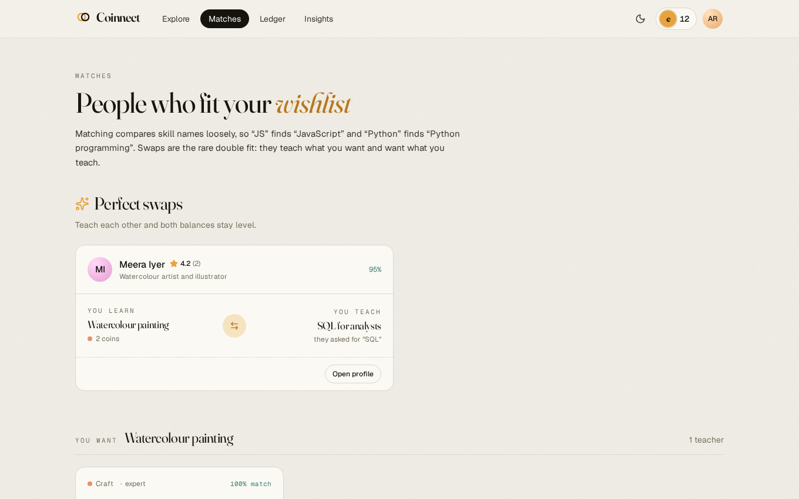
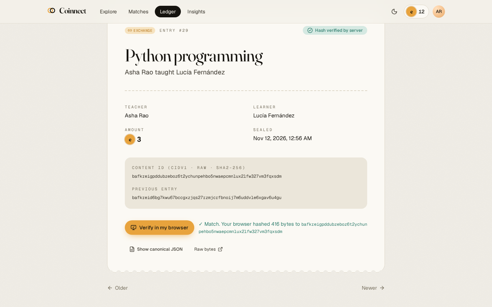
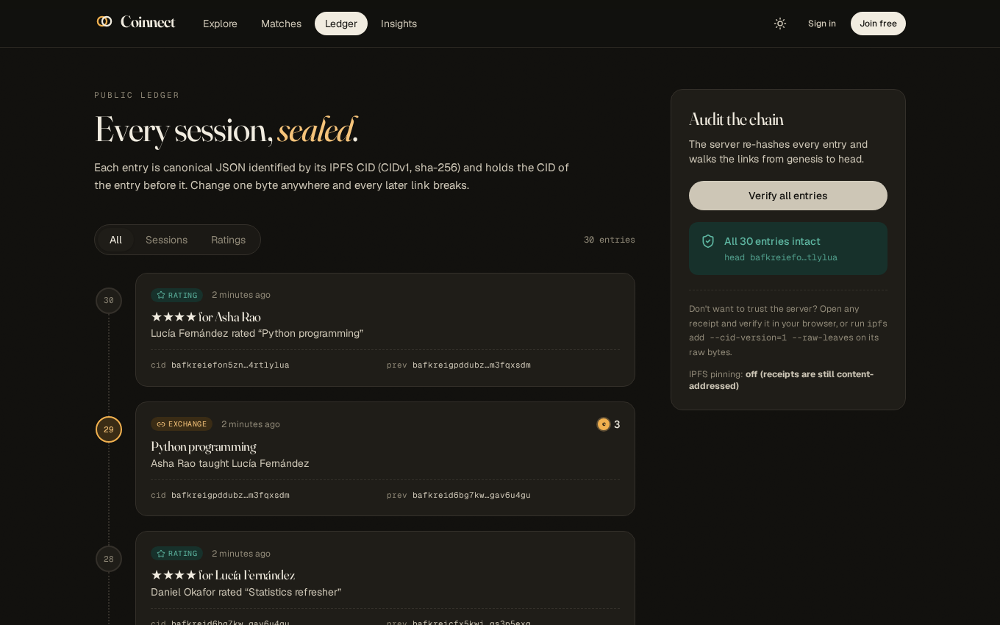

<div align="center">

# Coinnect

**Trade what you know.**

A peer-to-peer skill exchange. Teach a session to earn SkillCoins, spend them learning
from someone else, and keep a tamper-evident receipt for every session.


</div>

## What it does

- **Two-sided skill market.** Members list what they can teach (with a price in coins,
  level and availability) and what they want to learn. Browse, search and filter by
  category.
- **Fuzzy and reciprocal matching.** "JS" finds "JavaScript", "Python" finds "Python
  programming". *Perfect swaps* surface the double fit: someone who teaches what you want
  **and** wants what you teach.
- **Escrow, not trust-me payments.** Booking moves the fee out of the learner's balance
  into escrow. The teacher accepts or declines; the learner confirms the session happened,
  which releases the coins. Declines and cancellations refund automatically.
- **Content-addressed receipts.** Every completed session and every rating is written to
  an append-only ledger. Each entry is canonical JSON identified by its **IPFS CIDv1**, and
  each one contains the CID of the entry before it. Edit any historical byte and its CID
  changes and every later link breaks.
- **Verify without trusting the server.** The receipt page downloads the raw bytes and
  recomputes the CID in your browser with WebCrypto. The same CID comes out of
  `ipfs add --cid-version=1 --raw-leaves`, and receipts can optionally be pinned to IPFS.
- **Reputation that resists gaming.** Trust is a Bayesian average: everyone starts as if
  they had three 4.0 ratings, so one five-star review can't vault a newcomer above a
  member with forty. An integrity view flags unproven skill breadth, listing bursts, low
  trust and pairs who only ever rate each other five stars.

<table>
<tr>
<td width="50%"></td>
<td width="50%"></td>
</tr>
<tr>
<td width="50%"></td>
<td width="50%"></td>
</tr>
</table>

## Quick start

Requirements: **Python 3.10+** and **Node.js 20+**.

```bash
git clone https://github.com/Vc555s/Coinnect.git
cd Coinnect
./start.sh
```

Open **http://localhost:5173**. The first run creates a virtualenv, installs packages and
seeds a demo community. Click **Use the demo account** on the sign-in page, or log in as
`asha@coinnect.dev` / `demo1234` (every demo member uses that password). Asha has a
booking request waiting in her inbox.

`./start.sh --prod` builds the web app and serves everything from one process on
**http://localhost:8000**. Interactive API docs are at `/docs` in both modes.

<details>
<summary>Running the pieces by hand</summary>

```bash
# API
cd backend
python3 -m venv .venv && source .venv/bin/activate
pip install -r requirements.txt
uvicorn app.main:app --reload                 # http://localhost:8000

# Web app (second terminal)
cd frontend
npm ci
npm run dev                                   # http://localhost:5173, proxies /api to :8000
```
</details>

## How an exchange works

```
 learner books ──► pending ─── teacher accepts ──► accepted ─── learner confirms ──► completed
   (coins → escrow)    │                                │              (escrow → teacher,
                       ├── teacher declines ─► declined │               receipt sealed)
                       └── learner cancels ──► cancelled ◄┘
                                  (escrow → learner)
```

Only the teacher can accept or decline; only the learner can confirm or cancel. Balances
can't go negative (enforced in the database), and the ledger entry is written in the same
transaction as the coin transfer it records.

## The receipt ledger

A receipt is serialised as canonical JSON (sorted keys, no whitespace, UTF-8). Line-wrapped here for reading:

```json
{"data":{"amount":3,"completed_at":"2026-11-12T00:56:09+00:00","exchange_id":10,
"learner":{"id":3,"name":"Lucía Fernández"},"provider":{"id":1,"name":"Asha Rao"},
"requested_at":"2026-11-12T00:54:40+00:00","skill":"Python programming","unit":"SkillCoin"},
"kind":"exchange","prev":"bafkreid6bg7kwu67bccgxzjqs27rzmjcrfbnoij7m6uddvle6xgav6u4gu",
"schema":"coinnect/receipt@1","seq":29,"timestamp":"2026-11-12T00:56:09+00:00"}
```

Its identifier is the CIDv1 of those bytes: multibase base32 of
`0x01 (CIDv1) · 0x55 (raw) · 0x12 0x20 (sha2-256) · digest`, which is why every receipt
CID starts with `bafkrei`. Three ways to check one:

| Where | How |
|---|---|
| Browser | **Verify in my browser** on any receipt page |
| Server | `GET /api/ledger/verify` walks the whole chain from genesis |
| Anywhere | `curl -s localhost:8000/api/ledger/<cid>/raw \| ipfs add -n --cid-version=1 --raw-leaves -Q` |

Set `IPFS_RPC_URL` (a local `ipfs daemon`, or any Kubo-compatible pinning API) and each
receipt is also pinned to IPFS. The node must return the CID computed locally; a mismatch
is recorded, never silently accepted. Pinning failures never block an exchange.

## Architecture

```
frontend/  React 19 · TypeScript · Vite · Tailwind CSS 4 · TanStack Query · React Router
   │  /api (Vite proxy in dev, same origin in production)
backend/   FastAPI · SQLAlchemy 2 · Pydantic 2 · SQLite (any SQLAlchemy database works)
   ├─ app/routers/   accounts · skills & matching · exchanges · ledger & stats
   ├─ app/ledger.py  hash-chained receipts, chain verification
   ├─ app/cid.py     IPFS CIDv1 computation
   ├─ app/ipfs.py    optional pinning via Kubo RPC
   ├─ app/matching.py  fuzzy names + reciprocal swaps
   └─ app/reputation.py  Bayesian trust, integrity signals
```

Authentication uses scrypt password hashes and HMAC-signed bearer tokens, both from the
Python standard library.

### API overview

| Method | Path | |
|---|---|---|
| `POST` | `/api/auth/register`, `/api/auth/login` | Create an account (10 starting coins) / sign in |
| `GET` `PATCH` | `/api/me` | Your balance, escrow and trust; edit profile |
| `GET` | `/api/skills?q=&kind=offer\|request&category=&sort=` | Search the market |
| `POST` `PATCH` `DELETE` | `/api/skills[/{id}]` | Manage your listings |
| `GET` | `/api/matches` | Matches for your wishlist and perfect swaps |
| `POST` | `/api/exchanges` | Book a session (coins go to escrow) |
| `POST` | `/api/exchanges/{id}/accept\|decline\|cancel\|complete` | Move an exchange along |
| `POST` | `/api/exchanges/{id}/rate` | Rate the other member (1–5) |
| `GET` | `/api/ledger`, `/api/ledger/{cid}`, `/api/ledger/{cid}/raw` | Read receipts |
| `GET` | `/api/ledger/verify` | Verify the whole chain |
| `GET` | `/api/members[/{id}]`, `/api/stats`, `/api/integrity` | Profiles, metrics, integrity signals |

## Configuration

All optional; see [`backend/.env.example`](backend/.env.example).

| Variable | Default | |
|---|---|---|
| `DATABASE_URL` | `sqlite:///backend/data/coinnect.db` | Any SQLAlchemy URL |
| `SECRET_KEY` | generated, kept in `backend/data/` | Token signing key |
| `SEED_DEMO` | `true` | Seed demo members on an empty database |
| `STARTING_BALANCE` | `10` | Coins for each new member |
| `CORS_ORIGINS` | `http://localhost:5173` | Allowed browser origins |
| `IPFS_RPC_URL`, `IPFS_RPC_TOKEN` | unset | Enable IPFS pinning |
| `IPFS_GATEWAY` | `https://ipfs.io/ipfs/` | Gateway used for links to pinned receipts |

## Tests

```bash
cd backend && pip install -r requirements-dev.txt && pytest
```

The suite checks CIDs against known IPFS values, the full escrow lifecycle and its
permissions, refunds, insufficient balance, listing ownership, fuzzy and swap matching,
and that tampering with a stored receipt is detected.

## Limitations

- The ledger proves that receipts were not altered after the fact; it does not stop the
  operator of the server from refusing to record something. Pinning to IPFS lets others
  keep copies; anchoring the chain head on a public blockchain would be the next step.
- SkillCoins are an internal unit of account, not a cryptocurrency.
- There is no messaging or scheduling; members arrange the session time themselves after
  a request is accepted.
- Integrity signals are heuristics for a human moderator, not automatic sanctions.
